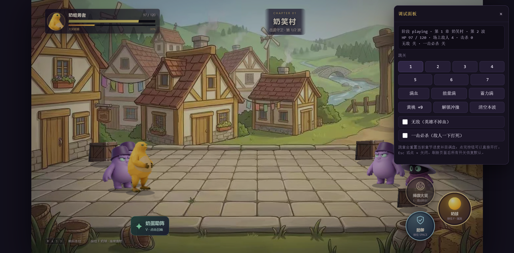

# 勇者奶蛙传 —— 源码恢复工程

从线上 H5 地址
`https://h5.metaapp.cn/online/h5/BUsvkkbBiAq2pF2Ttx4j/1.0.2/6/index.html`
恢复出来的可编辑、可构建、可部署的工程。

原版只做了压缩（Vite 生产构建 + 变量名混淆），没有额外保护，所以可以完整还原：
**逻辑、文案、数值、素材逐字节一致**；只有变量名是被压缩器改掉的短名（`a`、`t`、`e` 之类），
这部分无法还原成作者当初的命名 —— 已在代码里加了分节标题，并在
[`docs/ARCHITECTURE.md`](docs/ARCHITECTURE.md) 给出短名对照表。

## 快速开始

```bash
pnpm install
pnpm dev        # 本地开发 http://localhost:5173
pnpm build      # 产物在 dist/，可直接上传静态托管
pnpm preview    # 预览构建产物 http://localhost:4173
```

`dist/` 用的是相对路径（`base: './'`），**可以放在任意子目录**，和原来的
`/online/h5/<id>/1.0.2/6/` 这种部署方式一致。

> 建议用 `http://` 或 `https://` 打开，不要直接双击 `dist/index.html`：
> 图片校验用到 `crypto.subtle` 和 Cache Storage，`file://` 下会降级/报错。

## 部署到 GitHub Pages

```bash
pnpm deploy      # = bash tools/deploy-gh-pages.sh
```

脚本会 `pnpm build`，然后把 `dist/` 原样推到 `origin` 的 `gh-pages` 分支
（临时仓库提交，不污染 `main` 历史；带 `.nojekyll` 和 `* -text`，产物字节与 `dist/` 一致）。

仓库 Pages 设置：Source = `gh-pages` 分支 `/` 根目录。当前线上地址：

- https://zhider.github.io/Nailong-hero/

`vite.config.js` 里 `base: './'` 用的是相对路径，所以放在 `/Nailong-hero/` 这种子目录下也能正常加载。

## 调试 / 金手指

打开方式（任选其一）：

- 键盘依次敲 `n a i l o n g`（2.5 秒内，输入框里不算）
- `Ctrl + Shift + D`
- URL 加 `?debug=1`
- 控制台 `__nailongDebug.open()`

Esc 或点 × 关闭。面板内容：

| 功能 | 说明 |
| --- | --- |
| 跳关 1–7 | 直接进入对应章节，回满血、重置本章波次（标题/结算界面也能用，会先正常开局再切章） |
| 清空本波 | 秒杀场上所有敌人；连续扫 2 秒，所以 BOSS 的「灭笑君临」二阶段和召唤小怪也会被一起清掉，可直接推进到通关 |
| 无敌 | 英雄不掉血，面板里显示「已挡 N 次」 |
| 一击必杀 | 任何伤害都按「敌人剩余血量 + 1」结算，仍走正常的死亡/掉落/连击/经验流程 |
| 满血 / 能量满 / 蓄力满 / 黄桃 +9 / 解锁冲撞 | 数值直接拉满，HUD 立刻刷新 |

默认全关，刷新页面恢复，**正式对局不受影响**：`GameWorld` 上只有 `debug: { invincible, oneHit }` 两个开关，
判断点分别在 `hurt()`（英雄受伤）和 `damage()`（敌人受伤）各一处。

控制台里 `__nailongDebug.model()` 能直接拿到 `GameWorld`，可以随手改 `hp`、`energy`、`upgrades` 之类。



不想保留这个功能时：删掉 `src/debug.js` 和 `src/main.js` 末尾的 `initDebug({...})` 即可；
`core.js` 里两处 `this.debug?.xxx` 判断留着没有任何副作用。

## 目录结构

```
index.html              入口页（只有 <main id="app">）
vite.config.js          base './'，assetsDir 'build'
src/core.js             游戏核心：加载页 / 存档 / 数值表 / GameWorld（~3100 行）
src/main.js             表现层：资源校验 / 音频 / Phaser 场景 / DOM 界面（~5250 行）
src/debug.js            调试面板（金手指，默认关闭）
src/vendor/phaser.js    Phaser 3.90.0 原始打包产物
src/styles/*.css        两份样式（入口主题 + 界面）
public/assets/**        74 张 webp + 8 段 mp3 + 桃罐头 svg + 结局 mp4
public/manifest.json    PWA 清单
recovered/              线上原始抓取件（构建产物、CSS、素材），留档用
tools/                  还原与校验脚本
docs/                   架构说明、对照表、对比截图
```

## 两种构建产物

| 目标 | 做法 |
| --- | --- |
| 继续改代码 | 直接改 `src/*.js`，`pnpm build` |
| 只想原样部署 | `pnpm build` 即可，产物行为与线上一致 |

## 怎么验证「真的和线上一样」

1. **素材逐字节一致**：`recovered/asset-manifest.json` 里是原包内置的 74 个图片 SHA-256，
   本地 `public/assets` 全部通过校验；音频/视频与原站 `Content-Length` 一致。
2. **代码结构比对**：

   ```bash
   pnpm verify          # 差异报告：列出 src 相对线上产物动了哪些顶层语句
   pnpm verify:strict   # 严格模式：有任何差异就退出码 1
   pnpm verify:core     # 只比 core.js（恢复后未再改动，应该只剩还原时的构建期改写）
   ```

   `pnpm verify` 把 `src/*.js` 与 `recovered/assets/*.js` 做顶层语句级 AST 比对，
   分类成「一致 / 改动 / 删除 / 新增」。刚恢复完、没改过代码时 `--strict` 是 PASS；
   现在多了两类**有意为之**的差异：还原时的构建期改写（Vite 预加载运行时、`import('./main.js')`、
   CSS 改为 import，共 5 处，全在 core.js 一侧）和 2026-10 的广告移除（main.js 31 处，
   见 `docs/CHANGELOG-ads-removed.md`）。
3. **运行一致**：本地构建后与原站逐项对比 —— 请求的资源清单完全相同、控制台无报错
   （只有 Phaser 和 WebGL 的常规警告）、标题页/战斗场景/血条/波次/触控按钮表现一致。
   截图见 `docs/screenshots/live-battle.png`（线上）与 `docs/screenshots/recovered-battle.png`（本地构建）。

## 恢复流程（可复现）

```bash
# 1. 抓取（已完成，抓取件在 recovered/）
#    入口 index.html → assets/game-*.js + game-*.css + main-*.js + main-*.css + phaser-*.js
#    + 代码里引用的 public 素材（含 20MB 结局视频 assets/cinematics/ending.mp4）

# 2. 重新生成可读源码
node tools/restore.cjs      # 等价于 pnpm restore

# 3. 校验
node tools/verify-ast.cjs   # 等价于 pnpm verify
```

`tools/restore.cjs` 做四件事：prettier 重排（100 列 / 单引号 / 尾逗号）、剥掉构建期运行时、
把 chunk 间引用改成源码路径、按顶层语句位置插入分节注释。**不改任何逻辑**。

## 已知限制

- **变量名不可还原**：压缩器把局部变量改成了单字母，源码里的 `a`、`t`、`e`、`pa`、`Me`
  就是它们。`docs/ARCHITECTURE.md` 里有主要短名的含义表；类名和方法名（`attack`、`save`、
  `start` 等）没被压缩，仍然可读。
- **原工程的模块拆分不可还原**：Rollup 把小模块合并成了一个 chunk，恢复后按「核心 / 表现层」两段组织。
- **图片有内置哈希校验**：改图必须同步更新 `src/main.js` 里的 `qt` 清单，否则加载会中断。
- **结局视频 20MB**：`public/assets/cinematics/ending.mp4`，如果不需要可以在 `rt()` 里去掉。
- **广告已移除**：原版死亡后要看完 233 乐园激励视频才能重闯；现已整段删除（SDK 适配、
  `AdManager`、复活调度、`#death-ad-note` 文案与样式），改成「点一下直接重闯」。
  详见 `docs/CHANGELOG-ads-removed.md`。

## 内容速查

- 7 章：奶笑村 → 咕嘎小径 → 刀盾山道 → 风暴断桥 → 禁声堡垒 → 肃静大殿 → 无声王座
- 角色：奶蛙勇者、憋笑小兵、紫帽法师、发条炸弹、盾卫、摇铃怪、弹簧小丑、宝箱怪、锤兵、书记官、狗、企鹅、四位首领（captain / general / marshal / 憋笑魔王）
- 升级：防御强化、自动奶球、三连弹幕、穿透弹幕、连发、黄桃罐头、余震、大笑强化
- 存档：`naiwa-run-v1` / `naiwa-settings-v1` / `naiwa-best-v2` / `naiwa-touch-layout-v1`
